# TWELVE

**Twelve months. One hand. Three wrong taps and the year is gone.**

**Play: [digantshetty0006-ship-it.github.io/twelve](https://digantshetty0006-ship-it.github.io/twelve/)**



A one-button timing game played on a year dial. The hand sweeps through 365 days; you lock each month as it passes. Hit the middle of a month to keep it clear. Keep all twelve and the year is yours.

Most of my work is dashboards. This is the opposite: one dial, one key, no account. The year is the only deadline everyone shares.

## Rules

- The hand moves clockwise through all twelve months.
- Press `Space`, `Enter`, click the dial or tap it to lock the lit month.
- Three wrong taps end the run. There is no timer; the hand sets the pace.
- A lock near the centre of a month counts as **clear**.
- Keep all twelve months to keep all 365 days.

## Controls

| Key | Action |
| --- | --- |
| `Space` / `Enter` | Start, or lock the lit month |
| Click / tap the dial | Same as the key |
| `R` | Start the year over |
| `M` | Sound on / off |
| `?` or `H` | About |

## What's inside

- A hand-written SVG dial: 365 day ticks, 52 week ticks, 12 month sectors.
- Vanilla JavaScript. No framework, no build step, no dependencies.
- Web Audio API tones. No audio files.
- Best score in `localStorage`; nothing is sent anywhere.
- Keyboard controls, screen-reader status text and `prefers-reduced-motion` support.

## Run it locally

```bash
python -m http.server 8080
```

Then open `http://localhost:8080`.

## A note on the preview

`preview.svg` is a separate, animated version of the dial for the README. It is not the game. The game adds the clock, the sound and the mistakes.

---

Built by [Digant Shetty](https://github.com/digantshetty0006-ship-it) in Navi Mumbai.
