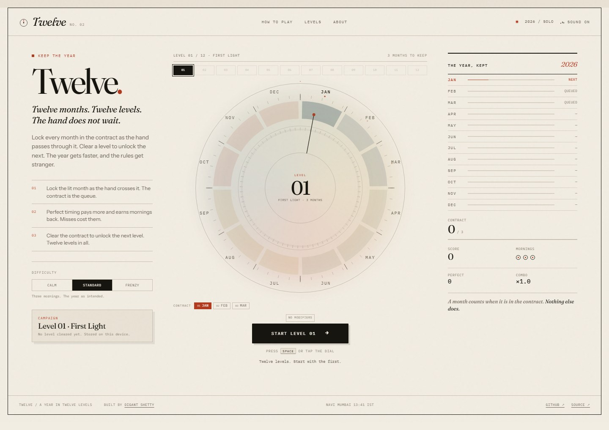

# TWELVE

**Twelve months. Twelve levels. One hand.**

**Play: [digantshetty0006-ship-it.github.io/twelve](https://digantshetty0006-ship-it.github.io/twelve/)**



A one-button timing game played on a year dial. Each level hands you a contract of months to keep. Lock them as the hand sweeps past; a perfect lock pays more and earns a morning back. Run out of mornings and the level gets away. The hand gets faster every level, and the rules change: shuffled contracts, mirage decoys, a blinking target, a reversing hand, speed gusts, and a narrower perfect window.

Most of my work is dashboards. This is the opposite: one dial, one key, no account. The year is the only deadline everyone shares.

## The campaign

- **12 levels**, from *First Light* to *The Long Year*, each with its own contract and twist.
- **Three difficulty modes.** Calm gives you 5 mornings, Standard 3, Frenzy 2 with a faster hand and a narrower perfect window.
- **Progress is saved.** Clear a level to unlock the next; your best score per level stays on the device.

## Rules

- The hand moves clockwise through all twelve months.
- Press `Space`, `Enter`, click the dial or tap it to lock the lit month.
- A month only counts when it is in the contract. Mirages and decoys do not.
- A lock near the centre of a month is **perfect**: bonus points, and every 4 perfect locks refund a morning.
- Run out of mornings and the level ends. Retry it or pick another unlocked level.

## Controls

| Key | Action |
| --- | --- |
| `Space` / `Enter` | Start, or lock the lit month |
| Click / tap the dial | Same as the key |
| `R` | Restart the current level |
| `L` | Open the level select |
| `M` | Sound on / off |
| `?` or `H` | About |

## What's inside

- A hand-written SVG dial: 365 day ticks, 52 week ticks, 12 month sectors.
- A 12-level campaign with a level rail, contract queue, modifiers, scoring and per-level bests.
- Vanilla JavaScript. No framework, no build step, no dependencies.
- Web Audio API tones. No audio files.
- Progress in `localStorage`; nothing is sent anywhere.
- Keyboard controls, screen-reader status text and `prefers-reduced-motion` support.

## Run it locally

```bash
python -m http.server 8080
```

Then open `http://localhost:8080`.

## A note on the preview

`assets/twelve-preview.jpg` is a screenshot of the game. The game itself adds the clock, the sound and the mistakes.

---

Built by [Digant Shetty](https://github.com/digantshetty0006-ship-it) in Navi Mumbai.
